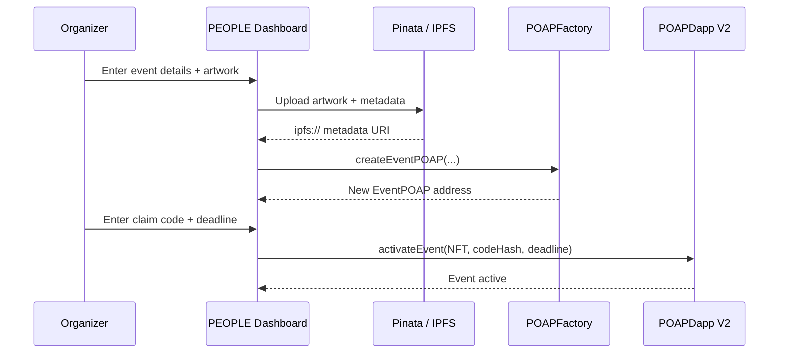

# PEOPLE

PEOPLE is a Web3 event-attendance dApp for issuing and claiming verifiable, non-transferable attendance NFTs.

The current pilot runs on **BOT Chain Bohr testnet** and is designed around a simple event flow: an organizer creates an event NFT, activates it with a claim code and deadline, attendees claim once for that event, and every claimed credential remains visible in **My POAPs**.

## Current Bohr deployment

| Component | Address |
| --- | --- |
| `POAPDapp` V2 | `0x506001C295d80944DE4ed4015af03Bb0E348aeB5` |
| `POAPFactory` | `0xAdf4d9B286D4c757d5aAce5EE544318F895A0E06` |
| Network | Bohr Testnet (`968`) |

The original Bohr controller remains deployed at `0x1807F7c4984f5188e948C2e828fadE1b2F0011eb` for historical compatibility, but new event collections should use the V2 controller above.

## How PEOPLE works

```mermaid
flowchart LR
    A[Organizer connects wallet] --> B[Create event NFT]
    B --> C[Artwork + metadata uploaded to IPFS]
    C --> D[POAPFactory deploys EventPOAP]
    D --> E[Organizer activates event]
    E --> F[Set claim code hash + deadline]
    F --> G[Attendee connects wallet]
    G --> H[Frontend validates claim code hash]
    H --> I[Attendee submits claim transaction]
    I --> J[POAPDapp V2 checks deadline + duplicate state]
    J --> K[EventPOAP mints soulbound NFT]
    K --> L[Credential appears in My POAPs]
```



## Core contracts

### `POAPDapp` V2

The reusable attendance controller.

It stores:
- the currently active EventPOAP contract;
- the active claim-code hash;
- the active claim deadline;
- owner/admin permissions; and
- claim state scoped by NFT collection.

Duplicate protection is event-specific:

```solidity
hasClaimed[nftContract][attendee]
```

A wallet can therefore claim Event A once, then later claim Event B once.

### `POAPFactory`

Creates event-specific `EventPOAP` collections.

Only the factory owner or approved factory admins can create collections. Factory administration is separate from claim-controller administration.

### `EventPOAP`

A soulbound ERC-721 attendance credential.

- Only its configured PEOPLE controller can mint.
- Transfers are disabled.
- Approvals are disabled.
- Event metadata is stored on IPFS.
- Attendee personal information is not placed in public metadata.

## Organizer flow



The dashboard never stores the plaintext claim code on-chain. It hashes the code before the transaction.

Changing the code updates the current event's claim settings without changing already minted NFTs or resetting that event's claim history.

## Attendee flow

1. Connect a wallet on Bohr.
2. Open the active event claim screen.
3. Enter the event claim code.
4. The frontend hashes the entered code and compares it with the current on-chain hash before opening the wallet.
5. Submit the claim transaction.
6. `POAPDapp` performs the authoritative on-chain validation.
7. Receive the soulbound attendance NFT.
8. Open **My POAPs** to view all PEOPLE credentials owned by the wallet.

## My POAPs

My POAPs is historical, not limited to the currently active event.

The frontend:
1. reads `EventPOAPCreated` logs from the existing factory;
2. discovers every PEOPLE event collection;
3. checks mint `Transfer` events for the connected wallet;
4. resolves each token's IPFS metadata and artwork; and
5. displays every credential the wallet has claimed.

Changing the active event therefore does not remove older POAPs from the user's gallery.

## Access control

There are two independent admin domains:

- **Claim controller admins** can activate events, update claim settings and stop minting.
- **Factory admins** can create new EventPOAP collections.
- Only the respective contract owner can grant or revoke admin access.

The dashboard shows owner-only admin management controls only to the connected owner wallet.

## Frontend stack

- Next.js
- React
- Wagmi
- RainbowKit / WalletConnect
- Viem
- Tailwind CSS
- Pinata + IPFS

## Environment

```env
NEXT_PUBLIC_WALLETCONNECT_PROJECT_ID=your_reown_project_id
NEXT_PUBLIC_POAP_DAPP_ADDRESS=0x506001C295d80944DE4ed4015af03Bb0E348aeB5
NEXT_PUBLIC_POAP_FACTORY_ADDRESS=0xAdf4d9B286D4c757d5aAce5EE544318F895A0E06
NEXT_PUBLIC_POAP_FACTORY_DEPLOY_TX=0x62e6c6b2468aee10741f705f30e7917d365f9981261a255da9d2e5e0c9a1fcca

PINATA_JWT=your_server_side_pinata_jwt
```

`PINATA_JWT` is server-side only and must never use the `NEXT_PUBLIC_` prefix.

The WalletConnect/Reown project ID is intentionally shown as a placeholder in documentation rather than hardcoded.

## Development

Frontend:

```bash
cd frontend
npm ci
npm run build
npm run dev
```

Contracts:

```bash
cd smart-contract
npm ci
npm test
```

## Security notes

- Only claim-code hashes are stored on-chain.
- Claim calldata still reveals the plaintext code once a claim transaction is submitted.
- Duplicate claims are tracked per EventPOAP collection.
- Event NFTs are soulbound.
- Privileged functions are owner/admin restricted.
- Pinata credentials stay server-side.
- Transaction errors are normalized into user-friendly UI messages.
- The current V2 controller is not upgradeable. Upgradeability can be introduced later as a separate production architecture decision.

## Historical controller

The first Bohr controller at `0x1807F7c4984f5188e948C2e828fadE1b2F0011eb` used global claim state and was suitable only for a single event.

It remains relevant for already-created historical collections whose immutable `minter` points to that controller. New events should use V2.
