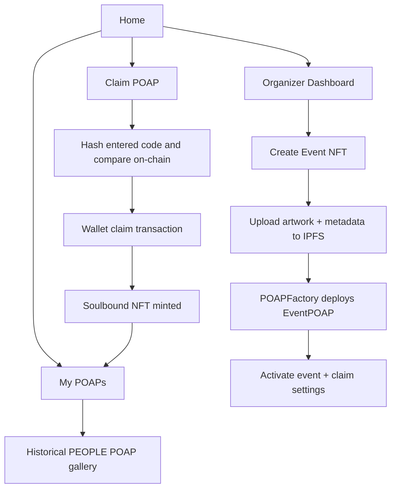
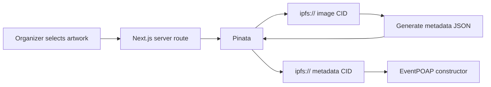

# PEOPLE Frontend

The PEOPLE frontend is the organizer and attendee interface for the Bohr attendance-NFT pilot.

It is built around the actual dApp flow rather than around raw smart-contract controls.

## Live configuration

| Setting | Value |
| --- | --- |
| Network | Bohr Testnet |
| Chain ID | `968` |
| `POAPDapp` V2 | `0x506001C295d80944DE4ed4015af03Bb0E348aeB5` |
| `POAPFactory` | `0xAdf4d9B286D4c757d5aAce5EE544318F895A0E06` |

## Frontend flow



## Pages

### Home

Introduces PEOPLE as a verifiable event-attendance platform and routes users into attendee or organizer flows.

### Claim

The attendee experience.

The page:
- reads the currently active NFT;
- reads the current claim deadline;
- reads the current on-chain claim-code hash;
- checks whether the connected wallet already claimed the active collection;
- hashes the entered code locally before opening the wallet;
- rejects an incorrect code immediately in the UI;
- submits the transaction only after preflight succeeds; and
- converts wallet/RPC errors into friendly messages.

Examples:
- `Insufficient BOT balance to pay network gas.`
- `Transaction cancelled.`
- `The claim period for this event has ended.`

The contract remains the authoritative source of truth.

### Organizer Dashboard

The dashboard is available to the controller/factory owner and approved admins.

Organizers can:
- create a new event attendance NFT;
- upload event artwork and metadata through the server-side Pinata route;
- activate a newly created collection;
- set or replace the claim code and deadline;
- stop minting;
- view active-event status; and
- manage claim/factory admins when connected as owner.

Event activation uses the V2 controller so the new NFT, code hash and deadline become active together.

### My POAPs

My POAPs is a historical wallet gallery.

It is not tied to only the currently active event.

The page:
- scans factory-created PEOPLE collections;
- finds mint events sent to the connected wallet;
- resolves metadata from IPFS;
- shows compact credential cards; and
- opens a larger detail view when a POAP is selected.

Older credentials remain visible after organizers activate newer events.

## IPFS flow



The Pinata JWT never reaches the browser.

## Environment variables

Create `frontend/.env.local`:

```env
NEXT_PUBLIC_WALLETCONNECT_PROJECT_ID=your_reown_project_id
NEXT_PUBLIC_POAP_DAPP_ADDRESS=0x506001C295d80944DE4ed4015af03Bb0E348aeB5
NEXT_PUBLIC_POAP_FACTORY_ADDRESS=0xAdf4d9B286D4c757d5aAce5EE544318F895A0E06
NEXT_PUBLIC_POAP_FACTORY_DEPLOY_TX=0x62e6c6b2468aee10741f705f30e7917d365f9981261a255da9d2e5e0c9a1fcca

PINATA_JWT=your_pinata_jwt
```

Optional:

```env
NEXT_PUBLIC_IPFS_GATEWAY=https://gateway.pinata.cloud/ipfs/
```

Do not commit `.env.local`.

## Build

```bash
npm ci
npm run build
npm run dev
```

## Responsive UI

The interface is designed for desktop, tablet and mobile.

Key layouts collapse to single-column flows on small screens, wallet/admin controls remain touch-friendly, and POAP cards use a compact gallery with a dedicated detail modal rather than oversized artwork cards.

## Historical controller

The original Bohr controller is:

`0x1807F7c4984f5188e948C2e828fadE1b2F0011eb`

New collections should use the V2 controller:

`0x506001C295d80944DE4ed4015af03Bb0E348aeB5`

because `EventPOAP.minter` is immutable.
